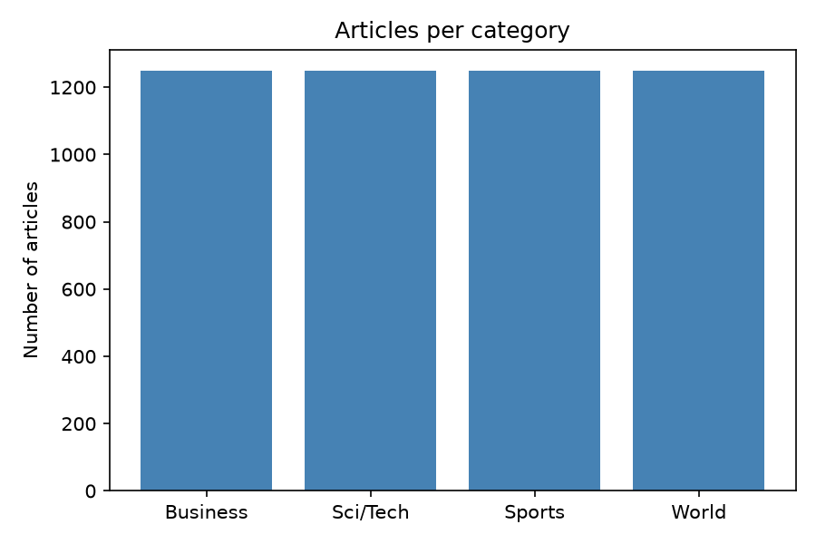
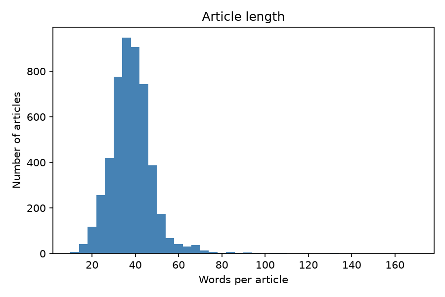
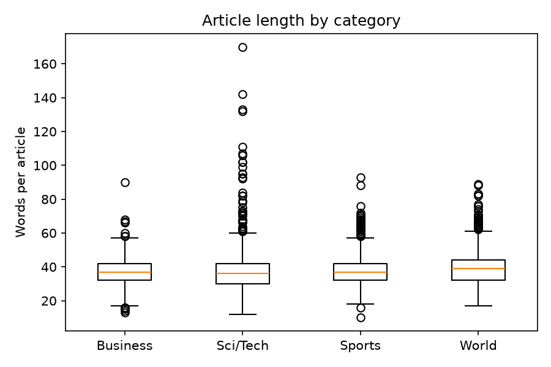
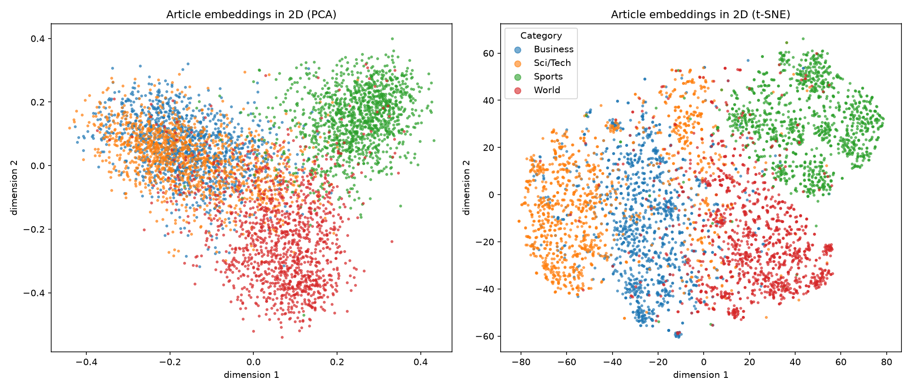

# Semantic Search with Embeddings

**Deep Learning Mini Project – Final Report**

| Member | Name | Part |
|---|---|---|
| 1 | Anvesha | Data preparation, data analysis, test queries, keyword search baseline, final testing |
| 2 | Mahima | Embedding generation, model comparison, embedding visualization |
| 3 | Harsh | Semantic search engine (FAISS) and evaluation |
| 4 | Mansi | Streamlit web app, README, final report and slides |

Code: https://github.com/Anvesha-1/semantic-search-embeddings

---

## Abstract

Keyword search engines return documents that contain the same words as the query, so they fail when the same idea is expressed in different words. This project builds a **semantic search** system that finds news articles by meaning. A balanced sample of 5,000 articles from the AG News dataset (World, Sports, Business, Sci/Tech) was cleaned and converted into 384-dimensional embeddings with the pre-trained sentence-transformer `all-MiniLM-L6-v2`. Queries are embedded with the same model, and the closest articles are found by cosine similarity using an exact FAISS index. On 40 test queries, semantic search reached a **Precision@5 of 93.5%**, against **84.0%** for a TF-IDF keyword baseline. The gain comes from paraphrased queries (**92% vs 72%**), while on queries that reuse the articles' own words both methods perform about the same (95% vs 96%). A larger model, `all-mpnet-base-v2`, did not improve accuracy (91.5%) and was about 5.6 times slower. The system is available through a Streamlit web app that lets users compare both search methods.

---

## Contents

1. Introduction and Data
2. Embeddings and Model Comparison
3. Semantic Search and Evaluation
4. Web Application
5. Conclusion
6. References

---
# Chapter 1: Introduction and Data

*Author: Anvesha (Member 1)*

## 1.1 Introduction

Search is one of the most common ways people find information. Most traditional search systems are **keyword-based**: they return documents that contain the same words as the query. This works well when the user happens to use the same words as the document, but fails when the same idea is expressed differently.

For example, the query **"cost of fuel goes up"** and a news article titled **"Oil prices rise"** mean almost the same thing, yet they share no important words. A keyword search engine gives this article a score of zero and never shows it to the user.

**Semantic search** solves this problem by searching on *meaning* instead of exact words. A pre-trained deep learning model (a sentence transformer) converts every document and every query into an **embedding**: a dense vector of numbers that represents its meaning. Texts with similar meanings get vectors that point in similar directions, so the most relevant documents can be found by measuring how close their vectors are to the query vector, using **cosine similarity**.

## 1.2 Objective

The objective of this project is to **build and evaluate a semantic search system for news articles** using sentence embeddings, and to show how it improves on a traditional keyword-based (TF-IDF) search, especially for queries that are phrased differently from the documents.

The project is divided into four parts:

1. Data preparation, test set and keyword baseline (this chapter)
2. Embedding generation (Chapter 2)
3. Semantic search engine and evaluation (Chapter 3)
4. Web application (Chapter 4)

## 1.3 Dataset

We use the **AG News** dataset, a widely used benchmark for text classification, which we load from Hugging Face (`fancyzhx/ag_news`). Its training set contains **120,000 news articles** in **4 categories**:

| Label | Category | Example topics |
|---|---|---|
| 0 | World | Politics, elections, conflicts, international relations |
| 1 | Sports | Football, Olympics, tennis, basketball |
| 2 | Business | Markets, companies, oil prices, economy |
| 3 | Sci/Tech | Computers, internet, space, science |

Each article consists of a **title and a short description**, which the Hugging Face version stores together in a single `text` field.

**Why this dataset suits the project:**

- It is public and free, and it loads with one line of code.
- The articles are short (a few sentences), so embeddings can be computed quickly on a normal laptop CPU.
- The **category labels** let us measure search quality automatically: a good result for a sports query should be a sports article.

**Sample size:** we use a **balanced random sample of 5,000 articles (1,250 per category)** rather than all 120,000. This keeps embedding generation fast (minutes instead of hours on a CPU) and ensures that no category dominates the search results or the evaluation. A fixed random seed (`42`) makes the sample identical every time the script runs, so all team members work with exactly the same data.

## 1.4 Preprocessing

The raw AG News text contains formatting errors left over from web scraping. The script `src/data_prep.py` applies these cleaning steps:

| Step | Problem | Fix |
|---|---|---|
| 1 | Broken HTML codes such as `#39;` and `quot;` | Replaced with `'` and `"` |
| 2 | HTML entities such as `&amp;` and `&lt;` | Converted to normal characters (`&`, `<`) |
| 3 | HTML tags such as `<b>...</b>` | Removed |
| 4 | Stray backslashes, for example `\band` | Replaced with a space |
| 5 | Repeated spaces and line breaks | Collapsed into one space |
| 6 | Very short texts (under 8 words) | Removed, as they carry too little meaning to search |
| 7 | Exact duplicate articles | Removed, so the same article doesn't appear twice in results |

**Example (before and after cleaning)**, taken from the first article in the AG News training set:

> **Before:** `Wall St. Bears Claw Back Into the Black (Reuters) Reuters - Short-sellers, Wall Street's dwindling\band of ultra-cynics, are seeing green again.`
>
> **After:** `Wall St. Bears Claw Back Into the Black (Reuters) Reuters - Short-sellers, Wall Street's dwindling band of ultra-cynics, are seeing green again.`

**What we deliberately did *not* do:** we did not remove stopwords, apply stemming or lowercase the text for the embedding model. Transformer models read the full sentence in context, and small words such as "not" or "against" can change the meaning, so they work best on natural, unmodified text. (Stopword removal *is* used in the keyword baseline, Section 1.7.)

After removing short texts and duplicates, the balanced 5,000-article sample was saved as `data/processed/corpus.csv` with these columns:

| Column | Meaning |
|---|---|
| `doc_id` | Article number, 0 to 4999, in row order |
| `text` | Cleaned title and description |
| `label` | Category number (0 to 3) |
| `category` | Category name |

`doc_id` is important for the rest of the project: row *i* of the embedding matrix (Chapter 2) belongs to the article with `doc_id` *i*. This is how search results are mapped back to article text.

## 1.5 Exploratory Data Analysis

The script `src/explore_data.py` produces the following charts and statistics.

**Overall statistics** (from `results/data_stats.md`):

- Total articles: 5,000
- Average length: 37.8 words
- Shortest article: 10 words, longest: 170 words



*Figure 1.1: Number of articles per category. All four categories have exactly 1,250 articles, confirming the sample is balanced.*



*Figure 1.2: Distribution of article length in words.* Most articles are short: 80% are between 27 and 48 words long, with a few long outliers of up to 170 words.



*Figure 1.3: Article length by category.* All four categories have very similar lengths (average 37.2 to 38.8 words), so no category has an advantage from simply containing more words.

**Most frequent words per category** (stopwords removed):

| Category | Top words |
|---|---|
| World | said, iraq, reuters, president, afp, minister, bush, new |
| Sports | game, season, new, win, night, team, league, time |
| Business | reuters, said, new, oil, company, prices, corp, york |
| Sci/Tech | new, microsoft, said, reuters, software, internet, space, computer |

**Observations:**

1. The dataset is perfectly balanced, so evaluation scores will not be biased toward any one category.
2. The articles are short, which suits the embedding model: `all-MiniLM-L6-v2` handles up to 256 tokens of input, and these texts fit well within that.
3. The top words match each category's topic (for example "iraq" and "minister" for World, "oil" and "company" for Business, "microsoft" and "software" for Sci/Tech), which confirms the labels are meaningful and can be used to judge search results.
4. News-agency names ("reuters", "afp") and general words ("said", "new") appear among the top words of several categories. These words do not describe the topic, which is why TF-IDF gives them a low weight and why meaning-based embeddings are useful.

## 1.6 Test Query Set

To evaluate the search systems fairly, we created **40 test queries** in `data/eval/test_queries.csv`: 10 for each category, split into two types.

| Type | Count | Description | Example |
|---|---|---|---|
| direct | 20 | Uses words that commonly appear in the articles | "oil prices rise" |
| paraphrase | 20 | Expresses the same idea in different words | "cost of fuel goes up" |

**Why two types?** Direct queries are expected to work reasonably well with both keyword and semantic search. Paraphrase queries share few or no words with the relevant articles, so they isolate the situation where semantic search should clearly outperform keyword search. Comparing the scores on the two types (Chapter 3) shows exactly where the deep learning model adds value.

**Relevance judgement:** a search result counts as correct if its category matches the query's `expected_category`. This is an approximation, since not every article in the right category is truly relevant, but it lets us score all 40 queries automatically without labelling 5,000 articles by hand.

## 1.7 Keyword Search Baseline (TF-IDF)

To show that semantic search is an improvement, we need something to compare it with. We built a keyword search baseline in `src/keyword_search.py` using **TF-IDF** (Term Frequency × Inverse Document Frequency) from scikit-learn.

**How it works:**

1. Each article becomes a vector with one position for every word (and two-word phrase) in the vocabulary.
2. Each word gets a weight. The weight is **high** when the word appears often in *that* article (term frequency) but rarely across all articles (inverse document frequency). Common words like "said" end up with low weights, and stopwords like "the" are removed completely.
3. The query is converted into the same kind of vector.
4. Articles are ranked by the **cosine similarity** between their vector and the query vector.

**Settings used:** English stopwords removed, single words and word pairs (`ngram_range=(1, 2)`), words appearing in only one article ignored (`min_df=2`), and sublinear term-frequency scaling.

**Limitation:** TF-IDF can only match exact words. If a query shares no vocabulary with an article, the similarity is 0, regardless of meaning. Running the demo shows this clearly:

```
Query: oil prices rise
  [0.414] (Business) Greenspan comments on oil prices Alan Greenspan says oil prices will have to rise a lot mo
  [0.296] (Business) US October Producer Prices Rise the Most Since 1990 (Update6) Prices paid to US producers
  [0.291] (Business) High oil prices hit China growth Rising oil prices are expected to hit China's growth rate

Query: cost of fuel goes up
  [0.247] (Sci/Tech) Battered Florida Counts the Cost After Frances (Reuters) Reuters - Floridians began moppin
  [0.179] (Sports) US goes distance in softball ATHENS, Greece -- He told them to play for themselves and for
  [0.174] (Business) Turbulent times for US airline companies NEW YORK : Storms, skyrocketing fuel prices, cutt
```

For the direct query "oil prices rise", all 3 results are relevant Business articles about oil prices. For the paraphrase "cost of fuel goes up", which means the same thing, the top result is a hurricane article (it matched only the word "cost") and the second is a softball article (it matched only "goes"). Only 1 of the 3 results is relevant, and every score is lower.

This limitation is the motivation for the embedding-based semantic search described in the following chapters.

**Design note:** `KeywordSearcher.search(query, top_k)` returns results in exactly the same format as the semantic search engine (`doc_id`, `text`, `category`, `score`). This allowed the evaluation (Chapter 3) and the web app (Chapter 4) to be developed and tested before the embeddings were ready, and lets them switch between the two methods by changing one line of code.

## 1.8 Summary

This chapter prepared the foundation for the project:

- A clean, balanced corpus of 5,000 news articles (`corpus.csv`)
- Exploratory analysis confirming the data's balance and quality
- A test set of 40 queries designed to measure search by meaning
- A TF-IDF keyword search baseline that shows the limitation of word matching

The next chapter describes how the articles are converted into embeddings using a pre-trained sentence-transformer model.

---

# Chapter 2: Embeddings and Model Comparison

*Written by Member 2.*

## 2.1 What is an embedding?

An embedding turns a piece of text into a list of numbers (a vector) so that texts with similar meaning get similar vectors. Keyword search only matches exact words. Embedding search compares meaning, so "cost of fuel goes up" can match an article about "oil prices rise" even though they share no words.

## 2.2 The model we use

We use the pre-trained model `all-MiniLM-L6-v2` from the `sentence-transformers` library.

- Each article becomes a vector of **384 numbers**.
- Every vector is **normalized** to length 1. This means the cosine similarity between two texts equals the inner product of their vectors, which makes search simple and fast.
- The model is pre-trained, so we do no training. Everyone who runs it gets the same embeddings.

## 2.3 How the embeddings were created

- `src/embedder.py` has the function `embed_texts(texts)`. It loads the model once and returns a float32 array of shape `(n, 384)`. The search engine uses this same function for queries, so queries and articles always live in the same vector space.
- `src/embed_corpus.py` embeds all 5,000 articles in `corpus.csv` and saves them to `data/processed/corpus_embeddings.npy` with shape `(5000, 384)`.
- Row `i` of the embeddings file matches `doc_id` `i` in `corpus.csv`. Embedding all 5,000 articles took **66.6 seconds** on a laptop CPU.

## 2.4 Quick meaning test

`src/test_embedder.py` compares pairs of sentences:

| Sentence A | Sentence B | Similarity |
|---|---|---|
| cost of fuel goes up | oil prices rise | **0.504** |
| cost of fuel goes up | football coach fired | 0.022 |

The two sentences with the same meaning score about 20 times higher than the unrelated pair, even though they share no words. In Chapter 1, keyword search could not find a good match for "cost of fuel goes up". This is the main reason for using embeddings.

## 2.5 Visualizing the embeddings

We cannot draw 384 dimensions, so `src/visualize_embeddings.py` reduces them to 2 dimensions in two ways: PCA and t-SNE. Each dot is one article, coloured by its category.



What the picture shows:

- **Sports** and **World** each form a clear, separate group.
- **Business** and **Sci/Tech** overlap in the middle. This makes sense, because many articles in those categories cover similar topics, such as company or technology news.
- The model was never told the categories. It only saw the text. The groups appear because articles with similar meaning get similar vectors.

## 2.6 Comparing two embedding models

We compared our model with a larger one, `all-mpnet-base-v2`, using the 40 test queries made in Chapter 1 (10 per category, half direct and half paraphrased).

**Method.** For each query we find the 5 articles with the highest cosine similarity and count how many belong to the expected category. This is **Precision@5**, averaged over the queries. Note that it checks the category, not whether each article is truly relevant to the query, so it is a rough measure.

**Results (Precision@5, %):**

| | all-MiniLM-L6-v2 | all-mpnet-base-v2 |
|---|---|---|
| Overall | **93.5** | 91.5 |
| Direct queries | **95.0** | 91.0 |
| Paraphrase queries | 92.0 | 92.0 |
| Business | **90.0** | 84.0 |
| Sci/Tech | **94.0** | 92.0 |
| Sports | 94.0 | **96.0** |
| World | **96.0** | 94.0 |
| Vector size | 384 | 768 |
| Time to embed 5,000 articles (s) | **66.6** | 373.7 |

**Findings.**

1. The smaller model scored slightly higher overall (93.5% vs 91.5%).
2. On paraphrase queries, which are the hardest, the two models tie at 92%.
3. The larger model is about **5.6 times slower** and its vectors are **twice as big**, so it needs more time and memory.
4. For this dataset the smaller model is the better choice: similar or better accuracy at a fraction of the cost. We use it in the final system.

**Limitations.** With only 40 queries, a difference of one or two points is small and could change with a different set of queries. The larger model may be better on harder tasks, such as long documents, but our articles are short (about 38 words on average).

## 2.7 Summary

- Pre-trained embeddings let us search by meaning instead of exact words.
- The 5,000 articles are embedded with `all-MiniLM-L6-v2` into a `(5000, 384)` array that the search engine uses.
- The 2D plot shows that the embeddings group articles by topic without any labels.
- The smaller model matched or beat the larger one on our test queries and was 5.6 times faster.

## Files for this chapter

| File | Purpose |
|---|---|
| `src/embedder.py` | `embed_texts()` function |
| `src/embed_corpus.py` | Creates `corpus_embeddings.npy` |
| `src/test_embedder.py` | Meaning test |
| `src/compare_models.py` | Model comparison |
| `src/visualize_embeddings.py` | 2D plot |
| `results/model_comparison.csv` | Comparison table |
| `results/model_comparison_per_query.csv` | Per-query results |
| `results/figures/embeddings_2d.png` | 2D picture |

---

# Chapter 3: Semantic Search and Evaluation

*Written by Member 3.*

## 3.1 Goal

The goal of this part is to build a search engine that finds articles by **meaning**, and to measure how much better it is than ordinary keyword search.

## 3.2 How the search works

1. **Offline step (done once).**Every article was turned into a 384-number vector in Chapter 2. These vectors are stored in `data/processed/corpus_embeddings.npy`.
2. **At search time.** The user's query is turned into a vector using the same function, `embed_texts()`, and the same model. Using the same model matters, because vectors from different models cannot be compared.
3. **Finding the closest articles.** The query vector is compared with all 5,000 article vectors and the 5 closest are returned.

### Cosine similarity

Cosine similarity measures how close two vectors point in the same direction. A score near 1 means very similar meaning, and a score near 0 means unrelated. All vectors in this project are normalized to length 1, so cosine similarity equals the **inner product** (the sum of the products of the matching numbers).

### FAISS and IndexFlatIP

FAISS is a library for fast vector search. We use `IndexFlatIP`:

- **Flat** means it compares the query with every vector, so the result is exact. For 5,000 articles this is instant, and there is no need for an approximate index.
- **IP** means inner product. Because the vectors are normalized, the inner product ranks the articles in the same order as cosine similarity.

### The SemanticSearcher class

`src/search.py` contains `SemanticSearcher`. Its `search(query, top_k=5)` method returns a list of results with `doc_id`, `text`, `category` and `score`. This is the same format as the keyword search from Chapter 1, so the web app can switch between the two by changing one line.

Row `i` of the embeddings file matches `doc_id` `i` in `corpus.csv`. The code checks that both have the same length when it starts.

## 3.3 How we measure quality

We use the 40 test queries from Chapter 1: 10 per category, half **direct** (using words found in the articles) and half **paraphrase** (saying the same thing in different words).

**Precision@5.** For each query we take the top 5 results and count how many are in the expected category. A query scores 5/5 = 100% if all 5 results are in the right category. We then average over the queries.

This measure checks the **category** of the results, not whether each article truly answers the query. It is a rough but fair way to compare the two methods on the same queries.

## 3.4 Results

| Precision@5 (%) | Semantic search | Keyword search |
|---|---|---|
| Overall | **93.5** | 84.0 |
| Direct queries | 95.0 | **96.0** |
| Paraphrase queries | **92.0** | 72.0 |
| Business | **90.0** | 78.0 |
| Sci/Tech | **94.0** | 90.0 |
| Sports | **94.0** | 80.0 |
| World | **96.0** | 88.0 |

The full results are in `results/evaluation_summary.csv` and `results/evaluation_per_query.csv`.

## 3.5 Discussion

1. **Semantic search is better overall**, 93.5% against 84.0%.
2. **The big difference is on paraphrase queries.** When the query uses different words from the article, semantic search keeps 92% while keyword search drops to 72%, a gap of 20 points. Keyword search can only match words, so a query like "cost of fuel goes up" cannot find an article that says "oil prices rise". Semantic search compares meaning, so it can.
3. **On direct queries the two methods are about equal.** Keyword search scores 96% against 95%. When the query contains the exact words of the article, word matching works very well. Semantic search does not lose much here, but it does not win either.
4. **Semantic search wins in every category.** The gap is largest in Business (12 points) and Sports (14 points). It is smallest in Sci/Tech (4 points), where the technical vocabulary is distinctive and keywords already work well.
5. **Sanity check.** Our semantic scores equal the scores that Member 2 measured separately for the same model (93.5% overall, 95.0% direct, 92.0% paraphrase). This shows that the FAISS search and the direct matrix calculation give the same ranking, as expected for an exact index.

## 3.6 Limitations

- There are only 40 queries, so one query changes a category score by 10 points and the overall score by 2.5 points. Small differences, such as 95% against 96% on direct queries, should not be over-read.
- Precision@5 checks the category, not true relevance. An article in the right category may still not answer the query, and a result in a neighbouring category (for example Business instead of Sci/Tech) may actually be useful.
- The articles are short (about 38 words on average), and the corpus has only 5,000 articles. Results on longer documents or a bigger collection could be different.
- An exact flat index is fine at this size. For millions of articles, an approximate index would be needed.

## 3.7 Summary

- We built `SemanticSearcher`, an exact FAISS search over 5,000 normalized embeddings.
- Semantic search reached **93.5%** Precision@5, against **84.0%** for keyword search.
- The advantage comes from paraphrase queries: **92%** against **72%**.
- On direct queries, keyword search is as good as semantic search.

## Files for this chapter

| File | Purpose |
|---|---|
| `src/search.py` | `SemanticSearcher` class (FAISS) |
| `src/evaluate.py` | Runs the 40 test queries on both methods |
| `results/evaluation_summary.csv` | Precision@5 summary table |
| `results/evaluation_per_query.csv` | Result for every query |

---

# Chapter 4: Web Application

*Written by Member 4 (Mansi).*

## 4.1 Goal

The search engines from Chapters 1 and 3 work from the command line. The goal of this part is to put them behind a simple web page, so that anyone can type a query, pick a search method and read the results without writing any code.

## 4.2 Technology

The app is built with **Streamlit**, a Python library that turns a Python script into an interactive web page. It needs no HTML, CSS or JavaScript. The whole app is one file, `app.py`, which imports the two search classes built by the team:

| Class | File | Built in |
|---|---|---|
| `SemanticSearcher` | `src/search.py` | Chapter 3 |
| `KeywordSearcher` | `src/keyword_search.py` | Chapter 1 |

Both classes have the same `search(query, top_k)` method and return results in the same format (`doc_id`, `text`, `category`, `score`). This is why the app can switch between them with a single drop-down menu.

## 4.3 How to run it

From the project folder, with the virtual environment active:

```
streamlit run app.py
```

Streamlit starts a local web server and opens the app in the browser at `http://localhost:8501`.

## 4.4 Features

**Sidebar (search settings)**

- **Search method:** a drop-down to choose *Semantic Search* or *Keyword Search*.
- **Number of results:** a slider from 1 to 20 (default 5).

**Main page**

- A text box for the query, with an example shown as a placeholder.
- A **Search Articles** button.
- The results, each in its own bordered box showing:
  - the rank and the article number (`doc_id`)
  - the article's **category**
  - the **similarity score**, with 4 decimal places
  - the full article text

## 4.5 How it works

1. The user types a query and clicks **Search Articles**.
2. The app checks which method is selected in the sidebar and loads that search engine.
3. It calls `searcher.search(query, top_k)` and displays the returned list.

**Caching.** Loading a search engine is the slow part. The semantic engine has to load the 5,000 embeddings, build the FAISS index and load the embedding model. The keyword engine has to build its TF-IDF matrix. Both loading functions use Streamlit's `@st.cache_resource` decorator, so each engine is built **once**, the first time it is used. After that, every search reuses it and returns almost instantly.

**Error handling.**

- An empty query shows a warning ("Please enter a search query.") instead of searching.
- If the data or embedding files are missing, the app shows a clear error asking the user to generate the project data first.
- Any other error is shown as a message on the page rather than crashing the app.

## 4.6 Example: the same query in both modes

The query **"cost of fuel goes up"** shows the difference between the two methods. In *Keyword Search* mode, the top 3 results are:

| Rank | Category | Score | Article (start) |
|---|---|---|---|
| 1 | Sci/Tech | 0.247 | Battered Florida Counts the Cost After Frances... |
| 2 | Sports | 0.179 | US goes distance in softball... |
| 3 | Business | 0.174 | Turbulent times for US airline companies... skyrocketing fuel prices... |

The first two results only matched single words ("cost" and "goes") and have nothing to do with fuel prices. In *Semantic Search* mode, the same query is matched by meaning. Chapter 3 measured this query at 5 out of 5 results in the expected Business category for semantic search, against 1 out of 5 for keyword search.

This side-by-side use of the two modes is the easiest way to demonstrate the project during the presentation.

## 4.7 Testing

The app was tested from a fresh download of the GitHub repository:

- `pip install -r requirements.txt` installed Streamlit and all other libraries without errors.
- The app loaded, and a search returned results with no errors in both *Semantic Search* and *Keyword Search* modes.
- Each result showed its rank, article number, category, score and text.

## 4.8 Limitations and future work

- **First search is slower.** The first semantic search takes a few seconds while the embedding model loads; later searches are fast because of caching.
- **Runs locally.** The app runs on the user's own computer. It could be deployed online, for example on Streamlit Community Cloud, so that others can use it from a link.
- **Possible improvements:**
  - a category filter, to search within one category only
  - a "Compare" mode showing keyword and semantic results side by side on one screen
  - highlighting the words in each result that match the query

## 4.9 Summary

- `app.py` gives the project a simple web interface built with Streamlit.
- Users choose the search method and number of results, type a query and read the results with their category and similarity score.
- Both search engines are cached, so searches after the first are fast.
- Running the same query in both modes shows the main result of the project: semantic search finds articles by meaning, even when the words are different.

## Files for this chapter

| File | Purpose |
|---|---|
| `app.py` | Streamlit web application |
| `src/search.py` | Semantic search engine used by the app |
| `src/keyword_search.py` | Keyword search engine used by the app |

---

# Chapter 5: Conclusion

This project built and evaluated a complete semantic search system for news articles, from raw data to a working web app.

**Main results**

| Precision@5 (%) | Semantic search | Keyword search |
|---|---|---|
| Overall | **93.5** | 84.0 |
| Direct queries | 95.0 | **96.0** |
| Paraphrase queries | **92.0** | 72.0 |

1. **Semantic search finds articles by meaning.** It beat keyword search overall (93.5% vs 84.0%) and in every one of the four categories.
2. **The advantage is on paraphrased queries.** When the query uses different words from the articles, semantic search keeps 92% while keyword search falls to 72%. This is exactly the problem described in Chapter 1.
3. **Keyword search is still good at exact matches.** On direct queries it performs as well as semantic search (96% vs 95%).
4. **A bigger model is not always better.** The small `all-MiniLM-L6-v2` model was as accurate as the larger `all-mpnet-base-v2` on this data, and about 5.6 times faster with half the vector size.
5. **The embeddings capture topics without being told.** The 2D plot in Chapter 2 shows articles grouping by category, although the model never saw the labels.

**Limitations**

- Only 40 test queries were used, so small differences (one or two points) are not reliable.
- Precision@5 checks whether a result is in the right category, not whether it truly answers the query.
- The corpus is small (5,000 short articles); results may differ on longer documents or a much larger collection.

**Future work**

- **Hybrid search:** combine keyword and semantic scores, so exact matches and meaning both count.
- **Better evaluation:** label truly relevant articles for each query and use measures such as MRR or nDCG.
- **Scaling up:** use the full 120,000 articles with an approximate FAISS index.
- **Fine-tuning:** adapt the embedding model to news text.
- **App improvements:** a category filter, a side-by-side compare mode, and online deployment.

---

# References

1. X. Zhang, J. Zhao and Y. LeCun, "Character-level Convolutional Networks for Text Classification," *Advances in Neural Information Processing Systems (NeurIPS)*, 2015. (AG News dataset)
2. N. Reimers and I. Gurevych, "Sentence-BERT: Sentence Embeddings using Siamese BERT-Networks," *Proceedings of EMNLP-IJCNLP*, 2019.
3. W. Wang et al., "MiniLM: Deep Self-Attention Distillation for Task-Agnostic Compression of Pre-Trained Transformers," *NeurIPS*, 2020.
4. J. Johnson, M. Douze and H. Jégou, "Billion-scale similarity search with GPUs," *IEEE Transactions on Big Data*, 2019. (FAISS)
5. F. Pedregosa et al., "Scikit-learn: Machine Learning in Python," *Journal of Machine Learning Research*, 12, 2011.
6. Sentence-Transformers documentation: https://www.sbert.net
7. Streamlit documentation: https://docs.streamlit.io
8. AG News on Hugging Face: https://huggingface.co/datasets/fancyzhx/ag_news
