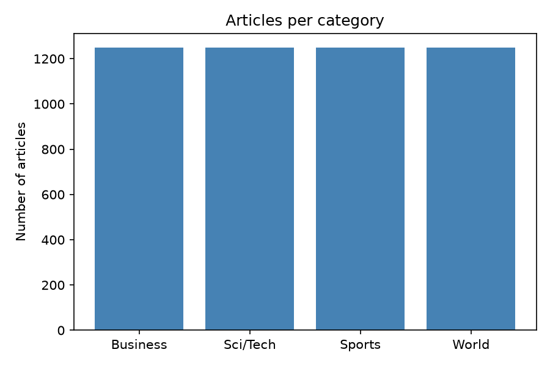
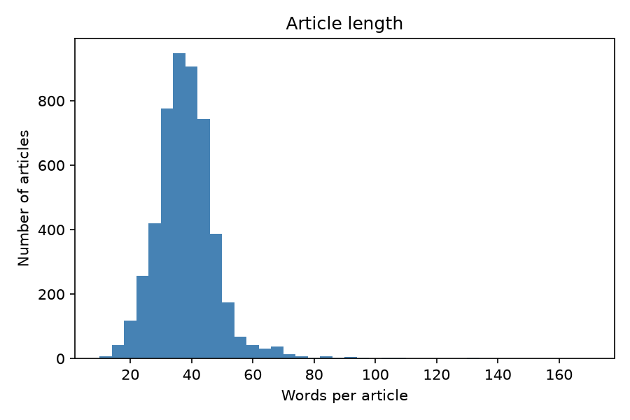
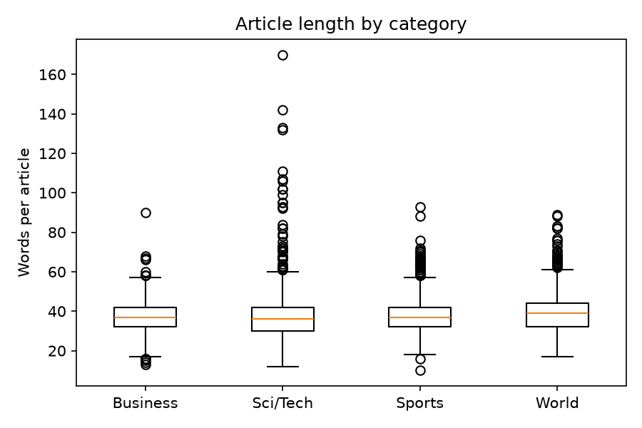

# Chapter 1: Introduction and Data

*Author: Anvesha (Member 1)*

## 1.1 Introduction

Search is one of the most common ways people find information. Most traditional search systems are **keyword-based**: they return documents that contain the same words as the query. This works well when the user happens to use the same words as the document, but fails when the same idea is expressed differently.

For example, the query **"cost of fuel goes up"** and a news article titled **"Oil prices rise"** mean almost the same thing, yet they share no important words. A keyword search engine gives this article a score of zero and never shows it to the user.

**Semantic search** solves this problem by searching on *meaning* instead of exact words. A pre-trained deep learning model (a sentence transformer) converts every document and every query into an **embedding**: a dense vector of numbers that represents its meaning. Texts with similar meanings get vectors that point in similar directions, so the most relevant documents can be found by measuring how close their vectors are to the query vector, using **cosine similarity**.

## 1.2 Objective

The objective of this project is to **build and evaluate a semantic search system for news articles** using sentence embeddings, and to show how it improves on a traditional keyword-based (TF-IDF) search, especially for queries that are phrased differently from the documents.

The project is divided into four parts:

1. Data preparation, test set and keyword baseline (this chapter)
2. Embedding generation (Chapter 2)
3. Semantic search engine and evaluation (Chapter 3)
4. Web application (Chapter 4)

## 1.3 Dataset

We use the **AG News** dataset, a widely used benchmark for text classification, which we load from Hugging Face (`fancyzhx/ag_news`). Its training set contains **120,000 news articles** in **4 categories**:

| Label | Category | Example topics |
|---|---|---|
| 0 | World | Politics, elections, conflicts, international relations |
| 1 | Sports | Football, Olympics, tennis, basketball |
| 2 | Business | Markets, companies, oil prices, economy |
| 3 | Sci/Tech | Computers, internet, space, science |

Each article consists of a **title and a short description**, which the Hugging Face version stores together in a single `text` field.

**Why this dataset suits the project:**

- It is public and free, and it loads with one line of code.
- The articles are short (a few sentences), so embeddings can be computed quickly on a normal laptop CPU.
- The **category labels** let us measure search quality automatically: a good result for a sports query should be a sports article.

**Sample size:** we use a **balanced random sample of 5,000 articles (1,250 per category)** rather than all 120,000. This keeps embedding generation fast (minutes instead of hours on a CPU) and ensures that no category dominates the search results or the evaluation. A fixed random seed (`42`) makes the sample identical every time the script runs, so all team members work with exactly the same data.

## 1.4 Preprocessing

The raw AG News text contains formatting errors left over from web scraping. The script `src/data_prep.py` applies these cleaning steps:

| Step | Problem | Fix |
|---|---|---|
| 1 | Broken HTML codes such as `#39;` and `quot;` | Replaced with `'` and `"` |
| 2 | HTML entities such as `&amp;` and `&lt;` | Converted to normal characters (`&`, `<`) |
| 3 | HTML tags such as `<b>...</b>` | Removed |
| 4 | Stray backslashes, for example `\band` | Replaced with a space |
| 5 | Repeated spaces and line breaks | Collapsed into one space |
| 6 | Very short texts (under 8 words) | Removed, as they carry too little meaning to search |
| 7 | Exact duplicate articles | Removed, so the same article doesn't appear twice in results |

**Example (before and after cleaning)**, taken from the first article in the AG News training set:

> **Before:** `Wall St. Bears Claw Back Into the Black (Reuters) Reuters - Short-sellers, Wall Street's dwindling\band of ultra-cynics, are seeing green again.`
>
> **After:** `Wall St. Bears Claw Back Into the Black (Reuters) Reuters - Short-sellers, Wall Street's dwindling band of ultra-cynics, are seeing green again.`

**What we deliberately did *not* do:** we did not remove stopwords, apply stemming or lowercase the text for the embedding model. Transformer models read the full sentence in context, and small words such as "not" or "against" can change the meaning, so they work best on natural, unmodified text. (Stopword removal *is* used in the keyword baseline, Section 1.7.)

After removing short texts and duplicates, the balanced 5,000-article sample was saved as `data/processed/corpus.csv` with these columns:

| Column | Meaning |
|---|---|
| `doc_id` | Article number, 0 to 4999, in row order |
| `text` | Cleaned title and description |
| `label` | Category number (0 to 3) |
| `category` | Category name |

`doc_id` is important for the rest of the project: row *i* of the embedding matrix (Chapter 2) belongs to the article with `doc_id` *i*. This is how search results are mapped back to article text.

## 1.5 Exploratory Data Analysis

The script `src/explore_data.py` produces the following charts and statistics.

**Overall statistics** (from `results/data_stats.md`):

- Total articles: 5,000
- Average length: 37.8 words
- Shortest article: 10 words, longest: 170 words



*Figure 1.1: Number of articles per category. All four categories have exactly 1,250 articles, confirming the sample is balanced.*



*Figure 1.2: Distribution of article length in words.* Most articles are short: 80% are between 27 and 48 words long, with a few long outliers of up to 170 words.



*Figure 1.3: Article length by category.* All four categories have very similar lengths (average 37.2 to 38.8 words), so no category has an advantage from simply containing more words.

**Most frequent words per category** (stopwords removed):

| Category | Top words |
|---|---|
| World | said, iraq, reuters, president, afp, minister, bush, new |
| Sports | game, season, new, win, night, team, league, time |
| Business | reuters, said, new, oil, company, prices, corp, york |
| Sci/Tech | new, microsoft, said, reuters, software, internet, space, computer |

**Observations:**

1. The dataset is perfectly balanced, so evaluation scores will not be biased toward any one category.
2. The articles are short, which suits the embedding model: `all-MiniLM-L6-v2` handles up to 256 tokens of input, and these texts fit well within that.
3. The top words match each category's topic (for example "iraq" and "minister" for World, "oil" and "company" for Business, "microsoft" and "software" for Sci/Tech), which confirms the labels are meaningful and can be used to judge search results.
4. News-agency names ("reuters", "afp") and general words ("said", "new") appear among the top words of several categories. These words do not describe the topic, which is why TF-IDF gives them a low weight and why meaning-based embeddings are useful.

## 1.6 Test Query Set

To evaluate the search systems fairly, we created **40 test queries** in `data/eval/test_queries.csv`: 10 for each category, split into two types.

| Type | Count | Description | Example |
|---|---|---|---|
| direct | 20 | Uses words that commonly appear in the articles | "oil prices rise" |
| paraphrase | 20 | Expresses the same idea in different words | "cost of fuel goes up" |

**Why two types?** Direct queries are expected to work reasonably well with both keyword and semantic search. Paraphrase queries share few or no words with the relevant articles, so they isolate the situation where semantic search should clearly outperform keyword search. Comparing the scores on the two types (Chapter 3) shows exactly where the deep learning model adds value.

**Relevance judgement:** a search result counts as correct if its category matches the query's `expected_category`. This is an approximation, since not every article in the right category is truly relevant, but it lets us score all 40 queries automatically without labelling 5,000 articles by hand.

## 1.7 Keyword Search Baseline (TF-IDF)

To show that semantic search is an improvement, we need something to compare it with. We built a keyword search baseline in `src/keyword_search.py` using **TF-IDF** (Term Frequency × Inverse Document Frequency) from scikit-learn.

**How it works:**

1. Each article becomes a vector with one position for every word (and two-word phrase) in the vocabulary.
2. Each word gets a weight. The weight is **high** when the word appears often in *that* article (term frequency) but rarely across all articles (inverse document frequency). Common words like "said" end up with low weights, and stopwords like "the" are removed completely.
3. The query is converted into the same kind of vector.
4. Articles are ranked by the **cosine similarity** between their vector and the query vector.

**Settings used:** English stopwords removed, single words and word pairs (`ngram_range=(1, 2)`), words appearing in only one article ignored (`min_df=2`), and sublinear term-frequency scaling.

**Limitation:** TF-IDF can only match exact words. If a query shares no vocabulary with an article, the similarity is 0, regardless of meaning. Running the demo shows this clearly:

```
Query: oil prices rise
  [0.414] (Business) Greenspan comments on oil prices Alan Greenspan says oil prices will have to rise a lot mo
  [0.296] (Business) US October Producer Prices Rise the Most Since 1990 (Update6) Prices paid to US producers
  [0.291] (Business) High oil prices hit China growth Rising oil prices are expected to hit China's growth rate

Query: cost of fuel goes up
  [0.247] (Sci/Tech) Battered Florida Counts the Cost After Frances (Reuters) Reuters - Floridians began moppin
  [0.179] (Sports) US goes distance in softball ATHENS, Greece -- He told them to play for themselves and for
  [0.174] (Business) Turbulent times for US airline companies NEW YORK : Storms, skyrocketing fuel prices, cutt
```

For the direct query "oil prices rise", all 3 results are relevant Business articles about oil prices. For the paraphrase "cost of fuel goes up", which means the same thing, the top result is a hurricane article (it matched only the word "cost") and the second is a softball article (it matched only "goes"). Only 1 of the 3 results is relevant, and every score is lower.

This limitation is the motivation for the embedding-based semantic search described in the following chapters.

**Design note:** `KeywordSearcher.search(query, top_k)` returns results in exactly the same format as the semantic search engine (`doc_id`, `text`, `category`, `score`). This allowed the evaluation (Chapter 3) and the web app (Chapter 4) to be developed and tested before the embeddings were ready, and lets them switch between the two methods by changing one line of code.

## 1.8 Summary

This chapter prepared the foundation for the project:

- A clean, balanced corpus of 5,000 news articles (`corpus.csv`)
- Exploratory analysis confirming the data's balance and quality
- A test set of 40 queries designed to measure search by meaning
- A TF-IDF keyword search baseline that shows the limitation of word matching

The next chapter describes how the articles are converted into embeddings using a pre-trained sentence-transformer model.