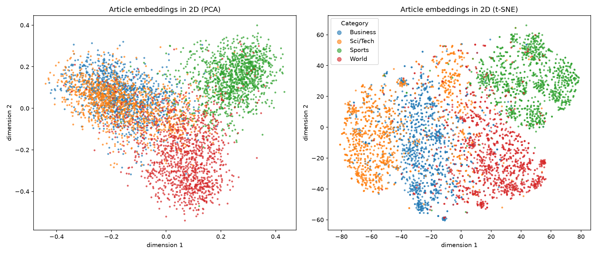

# Chapter 2: Embeddings and Model Comparison

*Written by Member 2.*

## 2.1 What is an embedding?

An embedding turns a piece of text into a list of numbers (a vector) so that texts with similar meaning get similar vectors. Keyword search only matches exact words. Embedding search compares meaning, so "cost of fuel goes up" can match an article about "oil prices rise" even though they share no words.

## 2.2 The model we use

We use the pre-trained model `all-MiniLM-L6-v2` from the `sentence-transformers` library.

- Each article becomes a vector of **384 numbers**.
- Every vector is **normalized** to length 1. This means the cosine similarity between two texts equals the inner product of their vectors, which makes search simple and fast.
- The model is pre-trained, so we do no training. Everyone who runs it gets the same embeddings.

## 2.3 How the embeddings were created

- `src/embedder.py` has the function `embed_texts(texts)`. It loads the model once and returns a float32 array of shape `(n, 384)`. The search engine uses this same function for queries, so queries and articles always live in the same vector space.
- `src/embed_corpus.py` embeds all 5,000 articles in `corpus.csv` and saves them to `data/processed/corpus_embeddings.npy` with shape `(5000, 384)`.
- Row `i` of the embeddings file matches `doc_id` `i` in `corpus.csv`. Embedding all 5,000 articles took **66.6 seconds** on a laptop CPU.

## 2.4 Quick meaning test

`src/test_embedder.py` compares pairs of sentences:

| Sentence A | Sentence B | Similarity |
|---|---|---|
| cost of fuel goes up | oil prices rise | **0.504** |
| cost of fuel goes up | football coach fired | 0.022 |

The two sentences with the same meaning score about 20 times higher than the unrelated pair, even though they share no words. In Chapter 1, keyword search could not find a good match for "cost of fuel goes up". This is the main reason for using embeddings.

## 2.5 Visualizing the embeddings

We cannot draw 384 dimensions, so `src/visualize_embeddings.py` reduces them to 2 dimensions in two ways: PCA and t-SNE. Each dot is one article, coloured by its category.

What the picture shows:

- **Sports** and **World** each form a clear, separate group.
- **Business** and **Sci/Tech** overlap in the middle. This makes sense, because many articles in those categories cover similar topics, such as company or technology news.
- The model was never told the categories. It only saw the text. The groups appear because articles with similar meaning get similar vectors.

## 2.6 Comparing two embedding models

We compared our model with a larger one, `all-mpnet-base-v2`, using the 40 test queries made in Chapter 1 (10 per category, half direct and half paraphrased).

**Method.** For each query we find the 5 articles with the highest cosine similarity and count how many belong to the expected category. This is **Precision@5**, averaged over the queries. Note that it checks the category, not whether each article is truly relevant to the query, so it is a rough measure.

**Results (Precision@5, %):**

| | all-MiniLM-L6-v2 | all-mpnet-base-v2 |
|---|---|---|
| Overall | **93.5** | 91.5 |
| Direct queries | **95.0** | 91.0 |
| Paraphrase queries | 92.0 | 92.0 |
| Business | **90.0** | 84.0 |
| Sci/Tech | **94.0** | 92.0 |
| Sports | 94.0 | **96.0** |
| World | **96.0** | 94.0 |
| Vector size | 384 | 768 |
| Time to embed 5,000 articles (s) | **66.6** | 373.7 |

**Findings.**

1. The smaller model scored slightly higher overall (93.5% vs 91.5%).
2. On paraphrase queries, which are the hardest, the two models tie at 92%.
3. The larger model is about **5.6 times slower** and its vectors are **twice as big**, so it needs more time and memory.
4. For this dataset the smaller model is the better choice: similar or better accuracy at a fraction of the cost. We use it in the final system.

**Limitations.** With only 40 queries, a difference of one or two points is small and could change with a different set of queries. The larger model may be better on harder tasks, such as long documents, but our articles are short (about 38 words on average).

## 2.7 Summary

- Pre-trained embeddings let us search by meaning instead of exact words.
- The 5,000 articles are embedded with `all-MiniLM-L6-v2` into a `(5000, 384)` array that the search engine uses.
- The 2D plot shows that the embeddings group articles by topic without any labels.
- The smaller model matched or beat the larger one on our test queries and was 5.6 times faster.

## Files for this chapter

| File | Purpose |
|---|---|
| `src/embedder.py` | `embed_texts()` function |
| `src/embed_corpus.py` | Creates `corpus_embeddings.npy` |
| `src/test_embedder.py` | Meaning test |
| `src/compare_models.py` | Model comparison |
| `src/visualize_embeddings.py` | 2D plot |
| `results/model_comparison.csv` | Comparison table |
| `results/model_comparison_per_query.csv` | Per-query results |
| `results/figures/embeddings_2d.png` | 2D picture |
